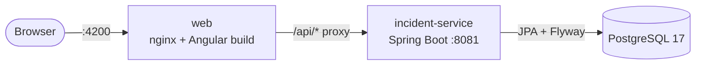

# Beacon

[](https://github.com/n1tishc/beacon/actions/workflows/ci.yml)

Beacon is a small incident management platform in the spirit of PagerDuty. Alerts come in, become incidents, and get acknowledged, resolved and written up.

It is built with **Java 21 / Spring Boot 3.5** microservices, an **Angular 22** frontend, **PostgreSQL**, and (in later slices) a serverless alert pipeline and Terraform-managed AWS infrastructure.

The project is built in **vertical slices**. Each slice ships end to end (UI → API → DB, tested, CI green) before the next one starts.

| # | Slice | Status |
|---|-------|--------|
| 1 | Walking skeleton: incident-service, Angular shell, Postgres, Docker Compose, CI | ✅ Shipped |
| 2 | Auth: auth-service, gateway, JWT, roles, guards | Planned |
| 3 | Incident lifecycle: state machine, timeline, optimistic locking, Testcontainers | Planned |
| 4 | Alert ingestion: API Gateway → Lambda → SQS, dedup, DLQ, LocalStack, live dashboard | Planned |
| 5 | Notifications: notification-service, Slack, Resilience4j | Planned |
| 6 | Postmortems: editor, S3 presigned uploads | Planned |
| 7 | AWS deploy: Terraform, GitHub Actions deploy job, smoke test | Planned |
| 8 | Hardening: Playwright E2E, coverage gate, Jenkinsfile, seed data, docs | Planned |

## Architecture (current slice)



The browser only ever talks to one origin. nginx serves the Angular bundle and proxies `/api` to the backend, so no CORS configuration is needed. In slice 2 the proxy target becomes the API gateway.

## Quick start

The only prerequisite is Docker (Docker Desktop, or Docker Engine with Compose v2).

```bash
docker compose up --build
```

| What | URL |
|------|-----|
| Web app | http://localhost:4200 |
| incident-service API | http://localhost:8081/api/incidents |
| Health / readiness | http://localhost:8081/actuator/health/readiness |
| Postgres | `localhost:5433` (user/password/db: `beacon`) |

Every setting has a working local default. To override anything, copy `.env.example` to `.env`; `.env` is git-ignored.

Try the API directly:

```bash
curl -i -X POST localhost:8081/api/incidents \
  -H 'Content-Type: application/json' \
  -d '{"title": "Checkout API returning 502s", "severity": "CRITICAL"}'

curl 'localhost:8081/api/incidents?page=0&size=20'
```

Stop with `docker compose down`. Add `-v` to also delete the database volume.

## Local development

Run Postgres in Docker and the apps on your machine, with hot reload.

**Requirements:** JDK 21 and Node 22.22+. Maven is not needed because the repo ships the Maven wrapper.

From the repo root:

```bash
# 1. Database only
docker compose up -d postgres

# 2. Backend on :8081 (the `local` profile points at the Postgres container). Runs in the foreground.
cd backend && ./mvnw -pl incident-service spring-boot:run -Dspring-boot.run.profiles=local
```

Then, in a second terminal from the repo root:

```bash
# 3. Frontend on :4200 (ng serve proxies /api to :8081, see frontend/proxy.conf.json)
cd frontend && npm ci && npm start
```

If you run this alongside the full Compose stack, stop the Compose `incident-service` and `web` containers first, since they use the same ports. The `local` profile assumes the default `beacon` credentials.

## Tests

```bash
cd backend && ./mvnw verify       # JUnit 5 + Mockito + MockMvc; JaCoCo report per module
cd frontend && npm run test:ci    # Vitest (jsdom), headless, single run
```

The JaCoCo HTML report is at `backend/incident-service/target/site/jacoco/index.html`.

CI (`.github/workflows/ci.yml`) runs three parallel jobs on every push and PR:
- Maven `verify`, with the JaCoCo report uploaded as an artifact
- the Angular tests and production build
- `docker compose up --build`, followed by a smoke test that creates and lists an incident through the nginx proxy. This covers real Postgres and the Flyway migrations, and proves the one-command setup works on a clean machine.

## API

| Method | Path | Description |
|--------|------|-------------|
| `POST` | `/api/incidents` | Trigger an incident. Body: `{title, description?, severity}`. Returns `201` with a `Location` header. |
| `GET` | `/api/incidents?page&size` | Incidents, newest first. `size` is limited to 1–100. |
| `GET` | `/api/incidents/{id}` | A single incident, or a `404` problem response. |

`severity` is one of `CRITICAL`, `HIGH`, `MEDIUM`, `LOW`. New incidents start as `TRIGGERED`.

Errors use [RFC 7807](https://www.rfc-editor.org/rfc/rfc7807) `application/problem+json`.

## Repository layout

```
backend/                Maven multi-module build (parent POM + one module per service)
  incident-service/     Spring Boot service: api/ (controllers, DTO records), service/, domain/ (entities, repositories)
  Dockerfile            One multi-stage Dockerfile for every service (--build-arg SERVICE=...)
frontend/               Angular 22 app (standalone components, signals, zoneless)
  src/app/incidents/    Feature folder: API client, signal store, dashboard, table, form
  nginx/                nginx config used by the frontend container
docker-compose.yml      The whole local stack
.github/workflows/      CI
```

Later slices add `infra/` (Terraform), `lambda/` (alert ingestion), `e2e/` (Playwright) and `load/` (k6).

## Configuration

Services read their configuration from environment variables. The `local` Spring profile supplies laptop defaults.

| Variable | Used by | Default (Compose) |
|----------|---------|-------------------|
| `DB_URL` | incident-service | `jdbc:postgresql://postgres:5432/beacon` |
| `DB_USERNAME` / `DB_PASSWORD` | incident-service | `beacon` / `beacon` |
| `PORT` | incident-service | `8081` |
| `JAVA_OPTS` | all JVM images | `-XX:+UseSerialGC -XX:MaxRAMPercentage=75 -Xss512k` |
| `POSTGRES_HOST_PORT` | compose | `5433` |
| `WEB_PORT` | compose | `4200` |

No secrets are committed. Real credentials come from GitHub Actions secrets and, once deployed, AWS.

## Design notes (so far)

- **Schema is owned by Flyway; Hibernate only validates it** (`ddl-auto: validate`). The app refuses to start if the entities and the migrations disagree. Later slices evolve the schema with new migrations instead of editing old ones.
- **DTOs are Java records, validated with Bean Validation at the controller boundary.** Entities never leave the service through the API. Paging uses a small `PageResponse` record instead of Spring's `PageImpl`, so the JSON shape is a deliberate contract.
- **Errors are RFC 7807 problem details** from the start (`spring.mvc.problemdetails.enabled`, plus `IncidentNotFoundException extends ErrorResponseException`). Slice 3 adds a `@RestControllerAdvice` with field-level validation errors.
- **Virtual threads** (`spring.threads.virtual.enabled`) let blocking JDBC code scale without a reactive rewrite.
- **Time comes from an injected `Clock`**, truncated to Postgres' microsecond precision. Tests are deterministic, and a create response matches a later read exactly.
- **The frontend store is a plain signals service** (`IncidentStore`): private writable state, public `computed` selectors, and methods as the only way to change state. That is enough structure for this app without the NgRx boilerplate.
- **OnPush everywhere.** OnPush is Angular 22's default, but components still declare it explicitly so readers who know older Angular can see it.
- **JVM sizing is decided up front.** The AWS deployment runs several services on one 1 GB t3.micro, so the images default to SerialGC and a percentage-based heap.
