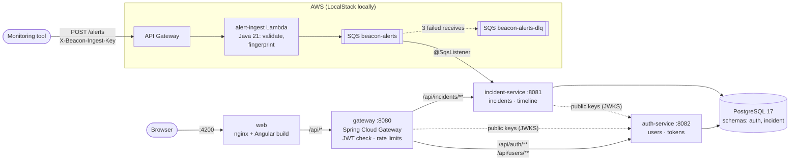
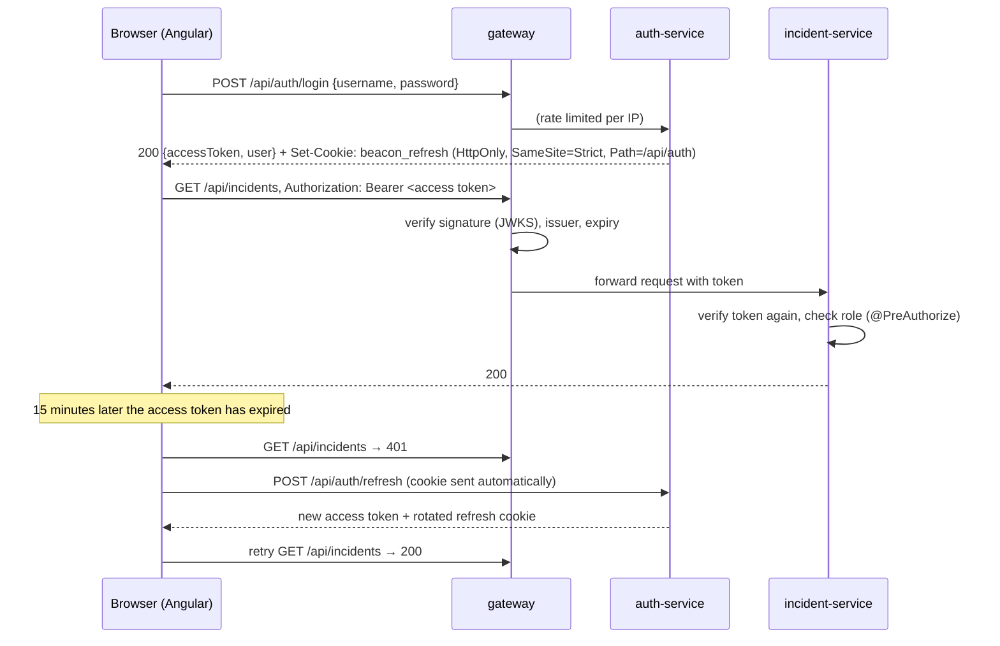
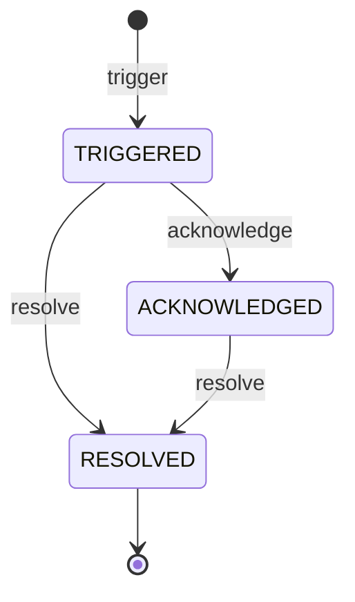
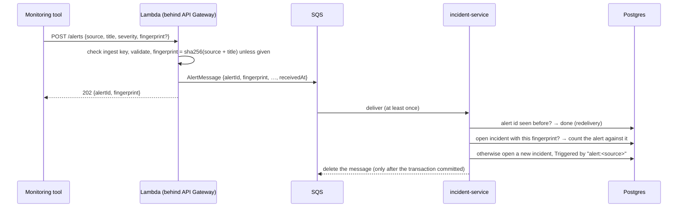

# Beacon

[](https://github.com/n1tishc/beacon/actions/workflows/ci.yml)

Beacon is a small incident management platform in the spirit of PagerDuty. Alerts come in, become incidents, and get acknowledged, resolved and written up.

It is built with **Java 21 / Spring Boot 3.5** microservices behind **Spring Cloud Gateway**, an **Angular 22** frontend, **PostgreSQL**, a serverless alert pipeline (**API Gateway → Lambda → SQS**, emulated locally with LocalStack) and, in a later slice, Terraform-managed AWS infrastructure.

The project is built in **vertical slices**. Each slice ships end to end (UI → API → DB, tested, CI green) before the next one starts.

| # | Slice | Status |
|---|-------|--------|
| 1 | Walking skeleton: incident-service, Angular shell, Postgres, Docker Compose, CI | ✅ Shipped |
| 2 | Auth: auth-service, gateway, JWT, roles, guards | ✅ Shipped |
| 3 | Incident lifecycle: state machine, timeline, optimistic locking, Testcontainers | ✅ Shipped |
| 4 | Alert ingestion: API Gateway → Lambda → SQS, dedup, DLQ, LocalStack, live dashboard | ✅ Shipped |
| 5 | Notifications: notification-service, Slack, Resilience4j | Planned |
| 6 | Postmortems: editor, S3 presigned uploads | Planned |
| 7 | AWS deploy: Terraform, GitHub Actions deploy job, smoke test | Planned |
| 8 | Hardening: Playwright E2E, coverage gate, Jenkinsfile, seed data, docs | Planned |

## Architecture (current slice)



- **One origin.** nginx serves the Angular bundle and proxies `/api` to the gateway, so the browser needs no CORS. The refresh cookie can also be `SameSite=Strict`.
- **The gateway is the only way in.** It rejects requests without a valid token and rate-limits clients. The services behind it are not published to the host.
- **Each service owns one schema** in a shared Postgres. Neither reads the other's tables.
- **Alerts never go through the gateway.** Monitoring tools post to API Gateway with a shared ingest key; the Lambda only validates and queues, and incident-service consumes the queue at its own pace. A burst of alerts, or incident-service being down, just means a longer queue.

### How authentication works



### The incident lifecycle



- **The transitions are code, in one place.** `IncidentStatus.canTransitionTo` is a `switch` over the enum. `Incident.acknowledge()` and `resolve()` are the only ways to change the status, and they throw on anything the table doesn't allow. A parameterized test lists all nine (from, to) pairs.
- **TRIGGERED → RESOLVED is allowed on purpose.** An alert that clears on its own, or a false positive, shouldn't need a ceremonial acknowledge first. PagerDuty works the same way. RESOLVED is terminal; a recurrence opens a new incident.
- **Every change lands on the timeline in the same transaction.** Domain methods return an event from a sealed `IncidentEvent` interface (`Triggered`, `Acknowledged`, `Resolved`, `NoteAdded`). The service persists each one as an append-only `timeline_entries` row. Because the interface is sealed, the `switch` that maps events to rows is checked by the compiler, so a new event type can't be silently forgotten.
- **Optimistic locking, at two levels.**
  1. Every command carries the `version` the user was looking at. If the incident has changed since, the API answers `409 Incident changed` instead of acting on a state the user never saw.
  2. Hibernate's `@Version` column catches two commands that pass that check at the same moment: the second `UPDATE … WHERE version = ?` matches no row, and the transaction fails with the same 409.

  An integration test fires eight concurrent acknowledges at one incident and checks that exactly one wins and exactly one timeline entry is written.
- **The UI reacts to the 409.** It reloads the incident and its timeline, keeps whatever the user had typed, and says that someone else changed it. The user then decides again with the current state in front of them.

### How alerts become incidents



- **Deduplication.** While an incident is open, every alert with its fingerprint is folded into it: `alertCount` goes up and `lastAlertAt` moves forward. Once it is resolved, the next alert opens a new incident. The first alert decides the title and severity; repeats never change what a responder may already be acting on.
- **Exactly-once effect on an at-least-once queue.** SQS standard queues can deliver a message twice. Every alert is stored under the id the Lambda gave it, so a redelivery hits the primary key and changes nothing.
- **Concurrent alerts for one problem open exactly one incident.** A partial unique index allows one open incident per fingerprint. When two alerts race, one insert fails; the listener retries once in a fresh transaction, sees the winner's incident and folds into it.
- **Repeats don't make anyone's copy stale.** The alert count is bumped with a single `UPDATE … SET alert_count = alert_count + 1`, which does not touch the `@Version` column. A noisy alert never turns a responder's acknowledge into a 409.
- **Failures go to the dead-letter queue.** A message is deleted only once it has been processed. An unreadable message, or one that keeps failing (say, the database is down), is retried by SQS and, after three receives, parked in `beacon-alerts-dlq` for inspection.
- **Alert-to-incident latency is measured, not guessed.** The Lambda stamps each alert with API Gateway's receive time. After the transaction commits, incident-service records the time since then in the `beacon.alerts.latency` timer, tagged by outcome.
  - Count and total time are at `/actuator/metrics/beacon.alerts.latency`.
  - p50/p95/p99 are a separate gauge: `/actuator/metrics/beacon.alerts.latency.percentile?tag=phi:0.95`. It covers a sliding window of about two minutes, so read it while alerts are flowing.
  - Both need a bearer token for any role. The gateway doesn't route `/actuator`, so query the service directly, e.g. `docker compose exec incident-service curl -H "Authorization: Bearer $TOKEN" localhost:8081/actuator/metrics/...`.
- **The dashboard is live.** It polls every 5 seconds while the tab is visible and refreshes as soon as you come back to it. Polling was chosen over WebSockets or SSE because it needs nothing new in the gateway, nginx or CloudFront, and a few seconds of delay is fine for this use. A slow response is never stacked on (`exhaustMap`), and a poll that started before you created an incident can't hide it again.

## Quick start

The only prerequisite is Docker (Docker Desktop, or Docker Engine with Compose v2).

```bash
docker compose up --build
```

Open http://localhost:4200 and sign in with one of the demo accounts. The password is `beacon-demo`, or whatever `DEMO_USER_PASSWORD` is set to.

| Username | Role | Can |
|----------|------|-----|
| `viewer` | VIEWER | view incidents |
| `responder` | RESPONDER | view, trigger, acknowledge and resolve incidents, add notes |
| `admin` | ADMIN | everything, plus manage users |

| What | URL |
|------|-----|
| Web app | http://localhost:4200 |
| API (gateway) | http://localhost:8080/api |
| Gateway health | http://localhost:8080/actuator/health/readiness |
| Postgres | `localhost:5433` (user/password/db: `beacon`) |
| Alert endpoint (LocalStack API Gateway) | http://localhost:4566/_aws/execute-api/beacon/local/alerts |

Every setting has a working local default. To override anything, copy `.env.example` to `.env`; `.env` is git-ignored.

Try the API directly:

```bash
TOKEN=$(curl -s -X POST localhost:8080/api/auth/login \
  -H 'Content-Type: application/json' \
  -d '{"username": "responder", "password": "beacon-demo"}' | jq -r .accessToken)

curl -i -X POST localhost:8080/api/incidents \
  -H "Authorization: Bearer $TOKEN" -H 'Content-Type: application/json' \
  -d '{"title": "Checkout API returning 502s", "severity": "CRITICAL"}'

curl localhost:8080/api/incidents -H "Authorization: Bearer $TOKEN"

# Acknowledge it. Send the version you last saw; a stale one gets a 409.
ID=$(curl -s localhost:8080/api/incidents -H "Authorization: Bearer $TOKEN" | jq -r '.content[0].id')
curl -X POST localhost:8080/api/incidents/$ID/acknowledge \
  -H "Authorization: Bearer $TOKEN" -H 'Content-Type: application/json' -d '{"version": 0}'

curl localhost:8080/api/incidents/$ID/timeline -H "Authorization: Bearer $TOKEN"
```

Send an alert the way a monitoring tool would, then send it again and watch the dashboard. The second one folds into the same incident:

```bash
curl -i -X POST localhost:4566/_aws/execute-api/beacon/local/alerts \
  -H 'X-Beacon-Ingest-Key: local-ingest-key' -H 'Content-Type: application/json' \
  -d '{"source": "prometheus", "title": "Checkout p99 above 2s", "severity": "HIGH"}'
```

The first alert after startup takes a few seconds, because LocalStack starts the Lambda's runtime container (a cold start). After that, it takes well under a second.

`scripts/smoke-test.sh` runs the same kind of checks against any running stack (it needs `jq`). CI runs it too.

Stop with `docker compose down`. Add `-v` to also delete the database volume.

## Local development

Run Postgres in Docker and the apps on your machine, with hot reload.

**Requirements:** JDK 21 and Node 22.22+. Maven is not needed because the repo ships the Maven wrapper.

From the repo root:

```bash
# Database and the AWS emulator (the alert queue)
docker compose up -d postgres localstack

# Once: install the parent POM and security-common so single-module runs can resolve them
cd backend && ./mvnw install -DskipTests && cd ..
```

Then start each of these from the repo root, each in its own terminal. They run in the foreground.

```bash
# auth-service on :8082 (the `local` profile seeds the demo users, password beacon-demo)
cd backend && ./mvnw -pl auth-service spring-boot:run -Dspring-boot.run.profiles=local

# incident-service on :8081
cd backend && ./mvnw -pl incident-service spring-boot:run -Dspring-boot.run.profiles=local

# gateway on :8080 (defaults already point at the two services on localhost)
cd backend && ./mvnw -pl gateway spring-boot:run

# Frontend on :4200 (ng serve proxies /api to the gateway, see frontend/proxy.conf.json)
cd frontend && npm ci && npm start
```

If you run this alongside the full Compose stack, stop the Compose containers that use the same ports first. The `local` profiles assume the default `beacon` credentials.

## Tests

```bash
cd backend && ./mvnw verify       # JUnit 5, Mockito, MockMvc, WireMock, Testcontainers (needs Docker)
cd frontend && npm run test:ci    # Vitest (jsdom), headless, single run
```

Each module writes a JaCoCo HTML report to `backend/<module>/target/site/jacoco/index.html`.

The security tests use **real signed tokens**. `security-common` publishes a `TestTokens` helper as a test-jar. It mints RS256 tokens exactly as auth-service does, and WireMock serves its public key as a JWKS. The gateway and incident-service then validate those tokens through their production decoder and role mapping, with nothing mocked. Among the cases covered:
- missing, expired and wrong-issuer tokens
- tokens signed with an unknown key
- each role against each endpoint
- ADMIN inheriting RESPONDER through the role hierarchy

auth-service's flow test runs against a real Postgres (Testcontainers). It covers:
- login
- the cookie's attributes
- refresh rotation
- replaying a used refresh token, which revokes every session for that user
- logout
- admin-only user management

incident-service's integration tests also run against a real Postgres:
- the full lifecycle over HTTP, including the timeline's order and actors, a stale-version 409 that changes nothing, and an illegal transition
- eight threads acknowledging the same incident at once, with exactly one winner
- a deterministic case where only the `@Version` column can stop a lost update
- the V2 migration run against a database that already holds V1 data, checking the backfill and the new constraints

The alert pipeline is tested at each hop:
- **The Lambda as plain Java:** the ingest key, validation, fingerprints, header case, base64 bodies, the 415 for non-JSON, and a check that rejections never log the key.
- **Its SQS publisher against LocalStack's real SQS API.**
- **The contract module:** pins the exact JSON of an `AlertMessage`. It is the format of messages already sitting in a queue, so changing it has to be deliberate.
- **incident-service's listener against LocalStack SQS (with a DLQ) and Postgres:**
  - first alert, repeats and resolve-then-repeat
  - a redelivered message counted once
  - 20 alerts sent in one burst
  - eight deliveries released at the same instant, which fight over the unique index and settle through the retry
  - a poison message that ends up in the dead-letter queue

CI (`.github/workflows/ci.yml`) runs three parallel jobs on every push and PR:
- Maven `verify`, with the JaCoCo reports uploaded as an artifact
- the Angular tests and production build
- `docker compose up --build`, followed by `scripts/smoke-test.sh` through the nginx proxy. The smoke test logs in as each role and checks the 401, 403 and 201 responses across all services. It then walks one incident through acknowledge and resolve, including a stale-version 409, and checks the timeline. Finally it sends alerts through API Gateway → Lambda → SQS: a wrong key is rejected, an alert becomes an incident, and a repeat folds into it.

## API

All endpoints go through the gateway. Errors use [RFC 7807](https://www.rfc-editor.org/rfc/rfc7807) `application/problem+json`.

| Method | Path | Who | Description |
|--------|------|-----|-------------|
| `POST` | `/api/auth/login` | anyone | `{username, password}` → `{accessToken, tokenType, expiresIn, user}`, plus the refresh cookie. Rate limited per IP. |
| `POST` | `/api/auth/refresh` | refresh cookie | Rotates the refresh cookie and returns a new access token. |
| `POST` | `/api/auth/logout` | refresh cookie | Revokes the session and clears the cookie. `204`. |
| `GET` | `/api/auth/me` | any role | The signed-in user. |
| `GET` | `/api/users` | ADMIN | All users. |
| `POST` | `/api/users` | ADMIN | Create a user: `{username, displayName, password (12+ chars), role}`. |
| `POST` | `/api/incidents` | RESPONDER | Trigger an incident: `{title, description?, severity}`. `201` with a relative `Location` header. |
| `GET` | `/api/incidents?page&size` | VIEWER | Incidents, newest first. `size` is limited to 1–100. |
| `GET` | `/api/incidents/{id}` | VIEWER | A single incident, or a `404` problem response. |
| `POST` | `/api/incidents/{id}/acknowledge` | RESPONDER | `{version}`. `409 Incident changed` if `version` is stale, `409 Transition not allowed` if the state machine says no. |
| `POST` | `/api/incidents/{id}/resolve` | RESPONDER | `{version, note?}`. Same `409`s as acknowledge. |
| `GET` | `/api/incidents/{id}/timeline` | VIEWER | Everything that happened to the incident, oldest first: type, actor, time, note. |
| `POST` | `/api/incidents/{id}/notes` | RESPONDER | `{text}`. Appends a note to the timeline. `201`. Notes don't change the incident, so they need no version. |

Alerts have their own endpoint, served by API Gateway and the Lambda, not by the gateway:

| Method | Path | Auth | Description |
|--------|------|------|-------------|
| `POST` | `/alerts` | `X-Beacon-Ingest-Key` | `{source, title, severity, description?, fingerprint?}` → `202 {alertId, fingerprint}`. `400`/`401`/`415` as problem details. |

Roles are hierarchical, ADMIN > RESPONDER > VIEWER, so "RESPONDER" means RESPONDER or ADMIN.

A validation failure is a `400` whose problem body lists each bad field, which the UI shows next to the matching input:

```json
{ "status": 400, "title": "Invalid request", "detail": "Some fields are missing or invalid.",
  "errors": [{ "field": "title", "message": "must not be blank" }] }
```

## Repository layout

```
backend/                Maven multi-module build
  security-common/      The JWT contract: roles, claim names, claims→authorities mapping, role hierarchy
  alert-contract/       The SQS message between the Lambda and incident-service, and its JSON codec
  alert-ingest-lambda/  AWS Lambda (plain Java 21, no Spring): validates alerts and queues them
  auth-service/         Users, login, access/refresh tokens, JWKS
  incident-service/     Incidents: api/ (controllers, DTO records), service/, ingest/ (SQS listener), domain/
  gateway/              Spring Cloud Gateway: routes, JWT check, in-memory rate limiter
  Dockerfile            One multi-stage Dockerfile for every service (--build-arg SERVICE=...)
frontend/               Angular 22 app (standalone components, signals, zoneless)
  src/app/core/auth/    Auth store, interceptor, guards
  src/app/login/        Login page
  src/app/incidents/    Feature folder: API client, stores, dashboard, table, form, detail page, timeline
  nginx/                nginx config used by the frontend container
infra/localstack/       LocalStack image + init script: API Gateway, the Lambda, SQS queue and DLQ
scripts/smoke-test.sh   End-to-end checks against a running stack
docker-compose.yml      The whole local stack
.github/workflows/      CI
```

Later slices add `infra/terraform/`, `e2e/` (Playwright) and `load/` (k6).

## Configuration

Services read their configuration from environment variables. The `local` Spring profiles supply laptop defaults, and `.env.example` lists everything Compose accepts.

| Variable | Used by | Default (Compose) |
|----------|---------|-------------------|
| `DB_URL`, `DB_USERNAME`, `DB_PASSWORD` | auth-service, incident-service | the Compose Postgres, `beacon` / `beacon` |
| `DEMO_USERS_ENABLED`, `DEMO_USER_PASSWORD` | auth-service | `true`, `beacon-demo` |
| `JWT_SIGNING_KEY` | auth-service | empty, so a key is generated at startup |
| `JWT_ISSUER` | all services | `beacon-auth` |
| `ACCESS_TOKEN_TTL`, `REFRESH_TOKEN_TTL` | auth-service | `15m`, `7d` |
| `AUTH_SECURE_COOKIE` | auth-service | `false` locally (plain http); `true` by default otherwise |
| `AUTH_JWKS_URI` | gateway, incident-service | `http://auth-service:8082/.well-known/jwks.json` |
| `AUTH_SERVICE_URL`, `INCIDENT_SERVICE_URL` | gateway | the Compose service names |
| `TRUSTED_PROXY_HOPS` | gateway | `1` (nginx) |
| `RATE_LIMIT_LOGIN_CAPACITY`, `RATE_LIMIT_API_CAPACITY` | gateway | `10` per minute per IP, `100` per 10 s per user |
| `INGEST_API_KEY` | alert Lambda | `local-ingest-key` |
| `ALERT_QUEUE` | incident-service | `beacon-alerts` |
| `SPRING_CLOUD_AWS_SQS_ENDPOINT`, `AWS_REGION`, `AWS_ACCESS_KEY_ID`, `AWS_SECRET_ACCESS_KEY` | incident-service | LocalStack (`http://localstack:4566`, `us-east-1`, `test`/`test`); in AWS no endpoint and the instance role's credentials |
| `LOCALSTACK_PORT` | LocalStack | `4566`, bound to `127.0.0.1` |
| `JAVA_OPTS` | all JVM images | `-XX:+UseSerialGC -XX:MaxRAMPercentage=75 -Xss512k` |

No secrets are committed. Real credentials come from GitHub Actions secrets and, once deployed, AWS.

## Design notes (so far)

### Security

- **RS256 with a published JWKS, not a shared HMAC secret.**
  - Only auth-service holds the private key. Everything else fetches the public key from `/.well-known/jwks.json` and caches it.
  - The key id is the key's own thumbprint, so rotating the key just means publishing a new one.
  - `JWT_SIGNING_KEY` is optional locally. Without it auth-service generates a key at startup. That only logs everyone out of their *access* tokens; refresh tokens live in the database, so clients just refresh.
- **Defence in depth.** The gateway checks that a token is valid, and each service checks it again and enforces roles itself with `@PreAuthorize`. A service reached without going through the gateway is still protected.
- **The JWT contract lives in code, in one place.**
  - `security-common` defines the role names, the claim names and the claim-to-authority mapping. Spring's default would read `scope`, not our `roles` claim.
  - It also defines the role hierarchy, so endpoints state the minimum role they need.
  - A contract test in auth-service feeds an issued token through the consumer's converter. That test catches drift between the issuer and the services.
- **Tokens in the browser.**
  - The access token is kept only in memory, never in `localStorage`, so an XSS payload can't lift it from storage.
  - The refresh token is an `HttpOnly; SameSite=Strict; Path=/api/auth` cookie. JavaScript can't read it, it is never sent cross-site, and it goes only to the refresh and logout endpoints. That is why those cookie-authenticated endpoints need no CSRF token.
  - A page reload restores the session through `/api/auth/refresh`, called from `provideAppInitializer`.
- **Refresh tokens are opaque, hashed, single-use and rotated.**
  - Each refresh revokes the old token and issues a new one. The database stores only SHA-256 hashes.
  - Presenting an already-rotated token means two parties hold it, so auth-service revokes all of that user's sessions.
  - A row lock prevents two concurrent refreshes with the same token from both succeeding.
  - Known tradeoff: two tabs refreshing at exactly the same moment trip the reuse detection and log the user out. Within one tab, the interceptor makes all concurrent 401s share a single refresh.
- **Login doesn't leak which usernames exist.** It goes through Spring Security's `DaoAuthenticationProvider`, which spends the same hashing time on unknown users, and a wrong password and an unknown user get the same response. Passwords use the delegating encoder (bcrypt, with an `{id}` prefix for future algorithm changes).
- **Rate limiting.**
  - The gateway runs the standard `RequestRateLimiter` filter with an in-memory token bucket (Caffeine-backed, so idle clients expire).
  - Clients are keyed by user id when authenticated and by IP otherwise. Login is limited per IP to slow down password guessing.
  - The client IP comes from `X-Forwarded-For`, trusting only as many entries as there are proxies in front of the gateway.
  - Tradeoff: the limits are per gateway instance. That is fine for one instance; for several, swap in Spring's `RedisRateLimiter` without changing the route config.
- **Demo accounts are seeded from an environment variable behind a flag.** They are never put in a migration, because password hashes in Flyway scripts would ship to production.
- **`Location` headers are relative** (`/api/incidents/{id}`, allowed by RFC 9110). They stay correct behind nginx and the gateway, and services don't need to trust `X-Forwarded-*` headers.

### Backend

- **Schema is owned by Flyway; Hibernate only validates it** (`ddl-auto: validate`). The app refuses to start if the entities and the migrations disagree. Each service migrates only its own schema (`spring.flyway.schemas`).
- **DTOs are Java records, validated with Bean Validation at the controller boundary.** Entities never leave the service through the API. Paging uses a small `PageResponse` record instead of Spring's `PageImpl`, so the JSON shape is a deliberate contract.
- **Errors are RFC 7807 problem details.** In incident-service one `@RestControllerAdvice` (`ApiExceptionHandler`) maps everything:
  - Domain exceptions are plain `RuntimeException`s that know nothing about HTTP; the advice maps them to `404`/`409`.
  - It extends `ResponseEntityExceptionHandler`, so Spring MVC's own errors (malformed JSON, unknown routes) come out in the same format.
  - Both kinds of validation failure, `@Valid` bodies and constrained `@RequestParam`s, produce the same `errors: [{field, message}]` list.
  - There is deliberately no catch-all `Exception` handler, because it would turn Spring Security's 403s into 500s. The role tests guard that.
- **The command order is fixed: not found, then stale version, then illegal transition.** A stale client is always told to reload, which helps, rather than getting a transition error that reloading would explain.
- **Ids are assigned by the entity, not the database.** The `Triggered` event can then carry the id before the first save. The version field is a `Long`, so Spring Data still recognises a new entity (`version == null`) and inserts it instead of merging.
- **Virtual threads** (`spring.threads.virtual.enabled`) let blocking JDBC code scale without a reactive rewrite. The gateway is the exception: it is reactive (WebFlux/Netty), as Spring Cloud Gateway is built.
- **Time comes from an injected `Clock`**, truncated to Postgres' microsecond precision. Tests are deterministic, and a create response matches a later read exactly.
- **JVM sizing is decided up front.** The AWS deployment runs several services on one 1 GB t3.micro, so the images default to SerialGC and a percentage-based heap.

### AWS and LocalStack

- **The Lambda is plain Java, with no Spring.** Every class it loads costs cold-start time. It uses the JDK's HTTP client instead of Netty or Apache and is shaded into one 8 MB jar. The logic sits in `AlertIngestor`, which knows nothing about Lambda; `AlertIngestHandler` only adapts API Gateway events to it.
- **The SQS message format lives in one module.** The Lambda writes with `AlertMessageCodec` and the listener reads with it. One test pins the exact JSON and another proves that unknown fields are ignored, so producer and consumer can be deployed independently.
- **LocalStack is pinned to 4.14,** the last release that runs without an account token: releases from 2026.03 on require one. Docker Compose and Testcontainers use the same version.
- **Locally, LocalStack runs real Lambda containers.** It needs the Docker socket for that, which is a local-only convenience. Its port is bound to `127.0.0.1`. LocalStack keeps state in memory, so alerts still queued when it restarts are lost; in AWS, SQS is durable.
- **incident-service refuses to start if its queue is missing** (`queue-not-found-strategy: fail`). By default Spring Cloud AWS would create the queue, without the dead-letter queue, and hide a misconfigured deployment.

### Frontend

- **Stores are plain signals services** (`AuthStore`, `IncidentStore`): private writable state, public `computed` selectors, and methods as the only way to change state. That is enough structure for this app without the NgRx boilerplate. `IncidentStore` clears itself when the user signs out.
- **Route guards use `canMatch`, not `canActivate`**, so a signed-out visitor never downloads the lazy-loaded feature chunk. After login the user returns to `returnUrl`, which only accepts in-app paths.
- **Role checks in the UI are a courtesy.** Viewers don't see the trigger form or the acknowledge/resolve controls, but the API is what enforces it. The buttons shown follow the same transition table as the backend (`canAcknowledge`, `canResolve`).
- **The detail page has its own store**, provided by the component rather than in root, so it lives and dies with the page. Commands return cold Observables, so nothing happens until the component subscribes. After every command the store reloads the incident and its timeline, so the page shows what the server has, not a guess.
- **nginx re-resolves the gateway's address.** It uses Docker's DNS resolver and a variable `proxy_pass`. With a plain hostname, nginx looks the address up once at startup and answers 502 after the gateway container is recreated.
- **OnPush everywhere.** OnPush is Angular 22's default, but components still declare it explicitly so readers who know older Angular can see it.
