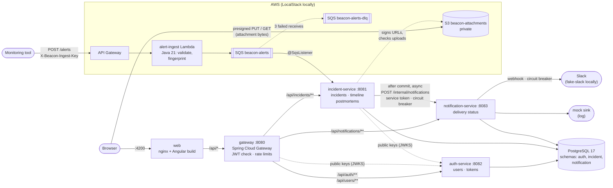
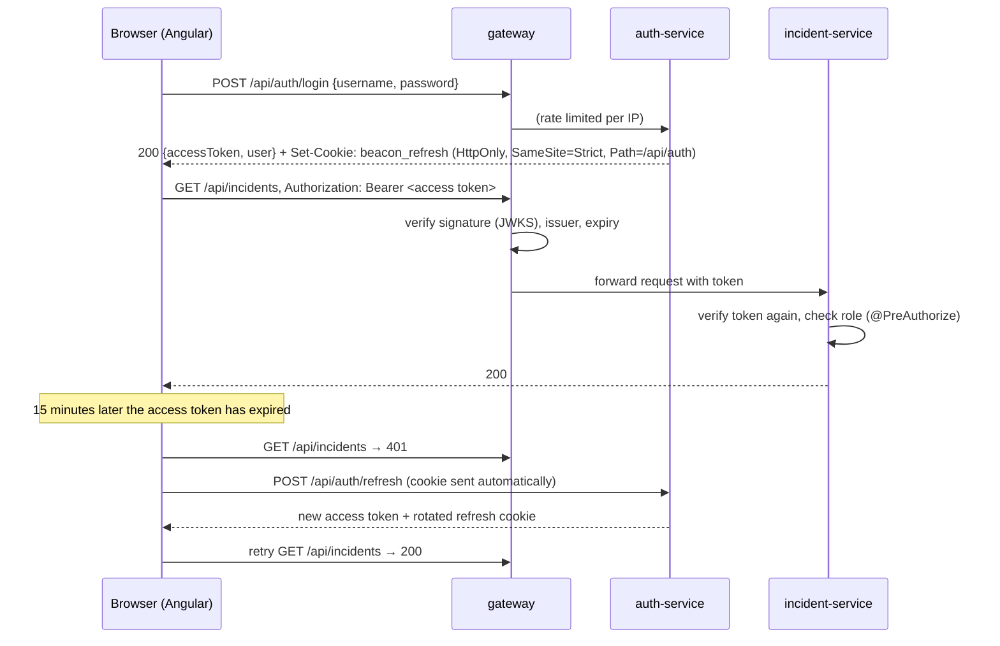
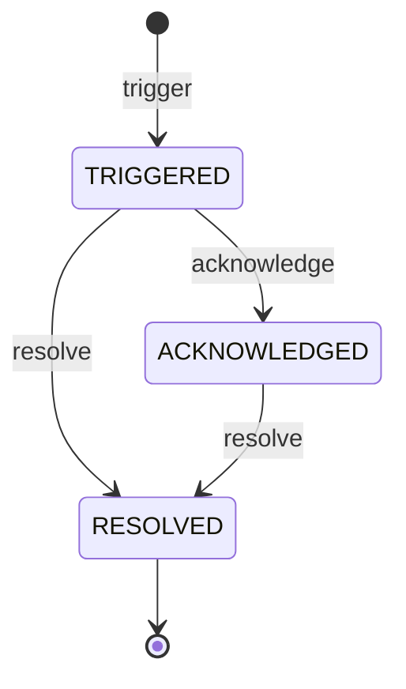
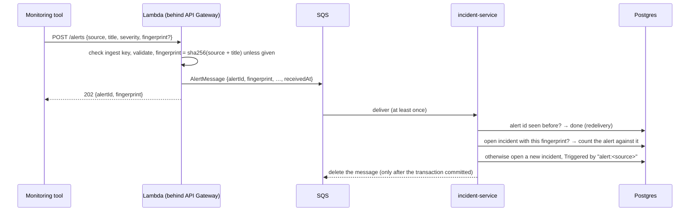
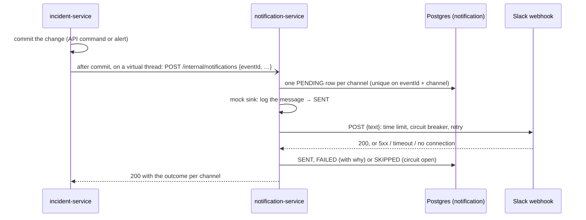
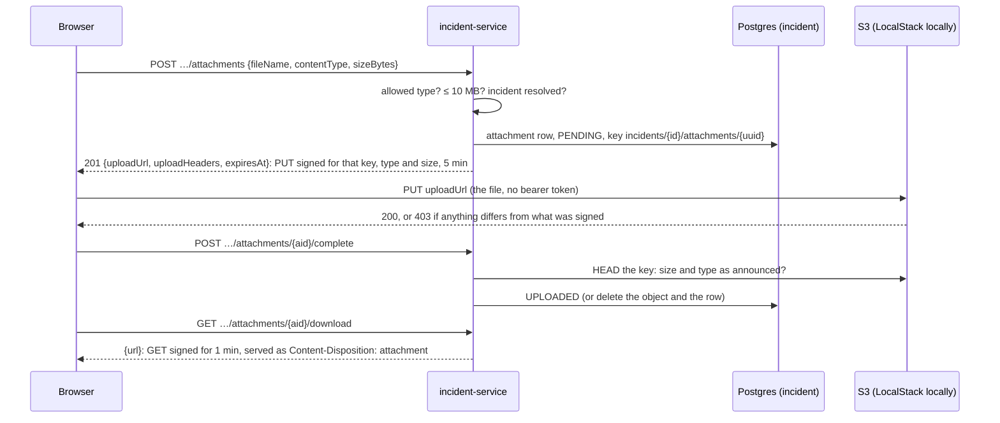
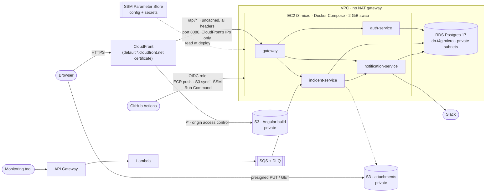

# Beacon

[](https://github.com/n1tishc/beacon/actions/workflows/ci.yml)

Beacon is a small incident management platform in the spirit of PagerDuty. Alerts come in, become incidents, and get acknowledged, resolved and written up.

It is built with **Java 21 / Spring Boot 3.5** microservices behind **Spring Cloud Gateway**, an **Angular 22** frontend, **PostgreSQL**, a serverless alert pipeline (**API Gateway → Lambda → SQS**, emulated locally with LocalStack), Slack notifications behind **Resilience4j** circuit breakers, and free-tier AWS infrastructure managed with **Terraform** and deployed by **GitHub Actions**.

**Beacon is complete.** All eight planned slices are built and tested. The project was built in **vertical slices**: each one shipped end to end (UI → API → DB, tested, CI green) before the next one started.

| # | Slice | Status |
|---|-------|--------|
| 1 | Walking skeleton: incident-service, Angular shell, Postgres, Docker Compose, CI | ✅ Shipped |
| 2 | Auth: auth-service, gateway, JWT, roles, guards | ✅ Shipped |
| 3 | Incident lifecycle: state machine, timeline, optimistic locking, Testcontainers | ✅ Shipped |
| 4 | Alert ingestion: API Gateway → Lambda → SQS, dedup, DLQ, LocalStack, live dashboard | ✅ Shipped |
| 5 | Notifications: notification-service, Slack + mock sink, Resilience4j circuit breaker | ✅ Shipped |
| 6 | Postmortems: editor, S3 presigned uploads | ✅ Shipped |
| 7 | AWS deploy: Terraform, GitHub Actions deploy job, smoke test | ✅ Built and validated offline |
| 8 | Hardening: Playwright E2E, coverage gate, Jenkinsfile, seed data, docs | ✅ Shipped |

The full stack and the smoke and E2E tests run in CI against Docker Compose and LocalStack. The AWS path is validated offline with `terraform validate` and `terraform test`, but a full deploy to AWS hasn't been completed, so there is no public URL. That is also why there are no load-test numbers here: a number that wasn't measured doesn't go in.

## Architecture



- **One origin.** nginx serves the Angular bundle and proxies `/api` to the gateway, so the browser needs no CORS. The refresh cookie can also be `SameSite=Strict`.
- **The gateway is the only way in.** It rejects requests without a valid token and rate-limits clients. The services behind it are not published to the host.
- **Each service owns one schema** in a shared Postgres. None reads another's tables.
- **Notifications are a side effect, never a dependency.** incident-service tells notification-service about a change only after it has committed, on a background thread. Neither Slack nor notification-service being down can fail or slow down an incident.
- **Attachment bytes never go through Beacon.** The browser uploads and downloads postmortem files straight to and from S3 with short-lived presigned URLs; incident-service only signs them and checks what arrived.
- **Alerts never go through the gateway.** Monitoring tools post to API Gateway with a shared ingest key; the Lambda only validates and queues, and incident-service consumes the queue at its own pace. A burst of alerts, or incident-service being down, just means a longer queue.

### How authentication works



### The incident lifecycle



- **The transitions are code, in one place.** `IncidentStatus.canTransitionTo` is a `switch` over the enum. `Incident.acknowledge()` and `resolve()` are the only ways to change the status, and they throw on anything the table doesn't allow. A parameterized test lists all nine (from, to) pairs.
- **TRIGGERED → RESOLVED is allowed on purpose.** An alert that clears on its own, or a false positive, shouldn't need a ceremonial acknowledge first. PagerDuty works the same way. RESOLVED is terminal; a recurrence opens a new incident.
- **Every change lands on the timeline in the same transaction.** Domain methods return an event from a sealed `IncidentEvent` interface (`Triggered`, `Acknowledged`, `Resolved`, `NoteAdded`). The service persists each one as an append-only `timeline_entries` row. Because the interface is sealed, the `switch` that maps events to rows is checked by the compiler, so a new event type can't be silently forgotten.
- **Optimistic locking, at two levels.**
  1. Every command carries the `version` the user was looking at. If the incident has changed since, the API answers `409 Incident changed` instead of acting on a state the user never saw.
  2. Hibernate's `@Version` column catches two commands that pass that check at the same moment: the second `UPDATE … WHERE version = ?` matches no row, and the transaction fails with the same 409.

  An integration test fires eight concurrent acknowledges at one incident and checks that exactly one wins and exactly one timeline entry is written.
- **The UI reacts to the 409.** It reloads the incident and its timeline, keeps whatever the user had typed, and says that someone else changed it. The user then decides again with the current state in front of them.

### How alerts become incidents



- **Deduplication.** While an incident is open, every alert with its fingerprint is folded into it: `alertCount` goes up and `lastAlertAt` moves forward. Once it is resolved, the next alert opens a new incident. The first alert decides the title and severity; repeats never change what a responder may already be acting on.
- **Exactly-once effect on an at-least-once queue.** SQS standard queues can deliver a message twice. Every alert is stored under the id the Lambda gave it, so a redelivery hits the primary key and changes nothing.
- **Concurrent alerts for one problem open exactly one incident.** A partial unique index allows one open incident per fingerprint. When two alerts race, one insert fails; the listener retries once in a fresh transaction, sees the winner's incident and folds into it.
- **Repeats don't make anyone's copy stale.** The alert count is bumped with a single `UPDATE … SET alert_count = alert_count + 1`, which does not touch the `@Version` column. A noisy alert never turns a responder's acknowledge into a 409.
- **Failures go to the dead-letter queue.** A message is deleted only once it has been processed. An unreadable message, or one that keeps failing (say, the database is down), is retried by SQS and, after three receives, parked in `beacon-alerts-dlq` for inspection.
- **Alert-to-incident latency is measured, not guessed.** The Lambda stamps each alert with API Gateway's receive time. After the transaction commits, incident-service records the time since then in the `beacon.alerts.latency` timer, tagged by outcome.
  - Count and total time are at `/actuator/metrics/beacon.alerts.latency`.
  - p50/p95/p99 are a separate gauge: `/actuator/metrics/beacon.alerts.latency.percentile?tag=phi:0.95`. It covers a sliding window of about two minutes, so read it while alerts are flowing.
  - Both need a bearer token for any role. The gateway doesn't route `/actuator`, so query the service directly, e.g. `docker compose exec incident-service curl -H "Authorization: Bearer $TOKEN" localhost:8081/actuator/metrics/...`.
- **The dashboard is live.** It polls every 5 seconds while the tab is visible and refreshes as soon as you come back to it. Polling was chosen over WebSockets or SSE because it needs nothing new in the gateway, nginx or CloudFront, and a few seconds of delay is fine for this use. A slow response is never stacked on (`exhaustMap`), and a poll that started before you created an incident can't hide it again.

### How notifications work, and how they fail



- **What notifies.** Triggered, acknowledged and resolved, whether a person or an alert caused it. Notes don't, and neither do repeat alerts folded into an open incident. Every change goes through one `IncidentEventRecorder`, which writes the timeline entry and publishes the event, so the API and the alert listener can't drift apart. Whether an event notifies is an exhaustive `switch` over the sealed `IncidentEvent`, so a new event type has to decide.
- **After commit, off the request thread.** A `@TransactionalEventListener(AFTER_COMMIT)` plus `@Async` (on virtual threads) means:
  - a rolled-back change never notifies anyone (an alert that lost a race and is retried, say);
  - neither the API response nor the SQS listener waits for notification-service, and nothing it does can fail them. A test points incident-service at a notification-service that hangs: the API answers while that notification is still being retried in the background.
- **The same three Resilience4j layers on both hops**, as Reactor operators so the order is visible in code. Innermost first:
  1. a **time limiter** per attempt (Slack 2 s; notification-service 10 s), so a timeout counts as a failure;
  2. a **circuit breaker** that counts every attempt. After 4 calls (Slack) or 5 (notification-service) with at least half failed, it opens, and calls fail at once without touching the remote side for 30 s. Then 2 trial calls decide whether it closes again;
  3. **retry**, outermost: 3 attempts with exponential backoff, only for 5xx, connection errors and timeouts. A 4xx (a revoked webhook, a wrong service token) is neither retried nor counted against the circuit, because Slack being up and rejecting us is not an outage.

  The fallback is a `catch` around all three. Putting it on the circuit breaker would hide failures from Retry.
- **Timeouts are budgeted, not guessed.** One Slack delivery takes at most 3 × 2 s + 1.5 s of backoff = 7.5 s. incident-service gives one call to notification-service 10 s, so it never retries a request that is still legitimately working on Slack.
- **Idempotent on the receiving side.** The request carries the timeline entry's id. notification-service stores it with a unique constraint per channel, so a retry after a lost response returns the first outcome and never posts to Slack twice.
- **Every outcome is recorded and visible.** Rows are written as PENDING before any channel is called, then become SENT, FAILED (with the reason and number of attempts) or SKIPPED (circuit open). The incident page lists them, and the dashboard shows each channel with Slack's circuit state. Error messages never include the webhook URL, which is a secret.
- **The service-to-service hop has its own credential.** `/internal/**` accepts only the shared `NOTIFICATION_SERVICE_TOKEN` (compared in constant time), a user's JWT doesn't open it, and the gateway has no route to it. One shared secret is enough for one caller; with more, the next step is short-lived service tokens from auth-service (OAuth2 client credentials).
- **Tradeoff: delivery is best effort.** If notification-service is unreachable for all three attempts, or its circuit is open, incident-service drops that notification and counts it in `beacon.notifications.dropped`. A FAILED Slack delivery isn't retried later either. The incident, the thing that matters, is always saved. Guaranteed delivery would mean a transactional outbox on both sides; for a pager that would be the next step. Two more consequences of the same choice:
  - Deliveries run concurrently, so Slack can show "resolved" just before "triggered" when they are seconds apart.
  - If notification-service dies mid-delivery, that row stays PENDING; nothing sweeps it up.
- **Circuit state through Actuator.** `circuitbreakers`, `circuitbreakerevents` and the `circuitBreakers` health component are exposed on both services; like metrics, they need a bearer token. An open circuit shows as `CIRCUIT_OPEN` but doesn't mark the service down (`allow-health-indicator-to-fail: false`), and readiness only covers the service itself, so a Slack outage never takes notification-service out of rotation.

  ```bash
  docker compose exec notification-service curl -s -H "Authorization: Bearer $TOKEN" localhost:8083/actuator/circuitbreakers
  ```
- **Delivery counts are metrics.** `beacon.notifications.deliveries` (tags `channel`, `status`) in notification-service, `beacon.notifications.dropped` in incident-service.

### How postmortem attachments are uploaded

A resolved incident gets a postmortem: summary, impact, root cause and action items, edited by responders and readable by everyone. Files attached to it (screenshots, graphs, logs, PDFs) are stored in S3.



- **Why presigned URLs.** File bytes go straight between the browser and S3, so a 10 MB upload never ties up a service thread or its memory. On the 1 GB instance this deploys to, that matters.
- **The server decides what may be uploaded, and S3 enforces it.**
  - The key is chosen by the server (`incidents/{incidentId}/attachments/{uuid}`), never from the file name, so an upload can only land under its own incident. The name is stored only as data.
  - The URL is signed with `Content-Type` and `Content-Length`. The integration tests assert this: S3 refuses a different type, a larger body, or a different key with 403.
  - Only images, PDFs, and text, CSV or JSON files, up to 10 MB. HTML and SVG are refused, because a browser would run script in them.
  - **Trust, then verify.** `complete` checks the object's size and type with a HEAD before listing it. Anything that doesn't match is deleted along with its row. The tests cover this by putting an object there without the URL.
- **Downloads can't be turned into a page.** A download URL lives for one minute and makes S3 answer with `Content-Disposition: attachment` and the stored type, so even a mislabeled file is saved, not rendered. The file name in that header is escaped (an ASCII fallback plus the RFC 6266 `filename*` form), and a test feeds it quotes and line breaks.
- **Two endpoints, one signature.** Inside Compose, incident-service reaches LocalStack as `localstack:4566`, but the browser reaches it as `localhost:4566`. The host is part of a presigned URL's signature, so the URL can't be rewritten afterwards. incident-service therefore defines its own `S3Presigner` for the public endpoint (`S3_PUBLIC_ENDPOINT`) and keeps Spring Cloud AWS's `S3Client` on the internal one. In AWS neither is set and both use S3's own endpoint.
- **LocalStack checks signatures here.** It skips presigned-URL validation unless `S3_SKIP_SIGNATURE_VALIDATION=0`, which Compose and the Testcontainers tests both set. Without it, the "S3 refuses a wrong type" tests would pass for the wrong reason.
- **The bucket is private, with one CORS rule:** `PUT` from the web app's origin with a `content-type` header. Downloads are plain navigations and need no CORS. The auth interceptor only adds the bearer token to `/api/` paths, and S3 would reject a request that carried one; a spec covers that.
- **The postmortem has its own `@Version`.** A save sends the version on screen, and a stale one gets `409 Postmortem changed`. Unlike an incident command, the page keeps the user's draft in the form, since it may be a lot of writing. It loads the other version and says who saved it, and the user either saves again to replace it or discards their draft. Someone saving a first draft when one already exists gets the same 409, rather than overwriting it; if two first drafts race to the database, the primary key stops the second.
- **S3 being down costs attachments, not postmortems.** Any AWS SDK error becomes `503 File storage unavailable`; the text of the postmortem still saves.
- **Tradeoffs:**
  - An upload that is announced but never completed leaves a PENDING row, and possibly an unlisted object; neither is ever shown. `AbandonedUploadCleanup` deletes both once they are an hour old (the upload URL lasts five minutes), every 15 minutes. It touches only PENDING uploads. That is why it is a job and not an S3 lifecycle rule: an age-based rule on `incidents/*` would delete real attachments too.
  - Attachments can't be deleted yet.
  - Angular's `withFetch()` backend doesn't report upload progress, so the page shows "Uploading…" rather than a progress bar. At 10 MB that's acceptable.

## Quick start

The only prerequisite is Docker (Docker Desktop, or Docker Engine with Compose v2).

```bash
docker compose up --build
```

Open http://localhost:4200 and sign in with one of the demo accounts. The password is `beacon-demo`, or whatever `DEMO_USER_PASSWORD` is set to.

| Username | Role | Can |
|----------|------|-----|
| `viewer` | VIEWER | view incidents |
| `responder` | RESPONDER | view, trigger, acknowledge and resolve incidents, add notes, write postmortems and attach files |
| `admin` | ADMIN | everything, plus manage users |

| What | URL |
|------|-----|
| Web app | http://localhost:4200 |
| API (gateway) | http://localhost:8080/api |
| Gateway health | http://localhost:8080/actuator/health/readiness |
| Postgres | `localhost:5433` (user/password/db: `beacon`) |
| Alert endpoint (LocalStack API Gateway) | http://localhost:4566/_aws/execute-api/beacon/local/alerts |
| What was "posted to Slack" (fake-slack) | http://localhost:8089/__admin/requests |

Every setting has a working local default. To override anything, copy `.env.example` to `.env`; `.env` is git-ignored.

Try the API directly:

```bash
TOKEN=$(curl -s -X POST localhost:8080/api/auth/login \
  -H 'Content-Type: application/json' \
  -d '{"username": "responder", "password": "beacon-demo"}' | jq -r .accessToken)

curl -i -X POST localhost:8080/api/incidents \
  -H "Authorization: Bearer $TOKEN" -H 'Content-Type: application/json' \
  -d '{"title": "Checkout API returning 502s", "severity": "CRITICAL"}'

curl localhost:8080/api/incidents -H "Authorization: Bearer $TOKEN"

# Acknowledge it. Send the version you last saw; a stale one gets a 409.
ID=$(curl -s localhost:8080/api/incidents -H "Authorization: Bearer $TOKEN" | jq -r '.content[0].id')
curl -X POST localhost:8080/api/incidents/$ID/acknowledge \
  -H "Authorization: Bearer $TOKEN" -H 'Content-Type: application/json' -d '{"version": 0}'

curl localhost:8080/api/incidents/$ID/timeline -H "Authorization: Bearer $TOKEN"
```

Send an alert the way a monitoring tool would, then send it again and watch the dashboard. The second one folds into the same incident:

```bash
curl -i -X POST localhost:4566/_aws/execute-api/beacon/local/alerts \
  -H 'X-Beacon-Ingest-Key: local-ingest-key' -H 'Content-Type: application/json' \
  -d '{"source": "prometheus", "title": "Checkout p99 above 2s", "severity": "HIGH"}'
```

The first alert after startup takes a few seconds, because LocalStack starts the Lambda's runtime container (a cold start). After that, it takes well under a second.

Every change also notifies Slack, which locally is the `fake-slack` container (WireMock, answering like a Slack webhook), and the mock sink, which logs to `docker compose logs notification-service`. To see an outage handled:

```bash
docker compose stop fake-slack     # trigger or acknowledge a few incidents: they still work,
                                   # Slack deliveries fail, then the dashboard shows "Circuit open"
docker compose start fake-slack    # about 30 s later trial calls go through and the circuit closes
```

To post to a real workspace, put its incoming-webhook URL in `.env` as `SLACK_WEBHOOK_URL`.

Resolve an incident and its page links to the postmortem. Attachments go to LocalStack's S3, in the `beacon-attachments` bucket; list them with `docker compose exec localstack awslocal s3 ls s3://beacon-attachments --recursive`. Open the app at `http://localhost:4200`, not `127.0.0.1`, because the bucket's CORS rule names that origin.

To fill a fresh stack with realistic data (incidents in every state, notes, repeated alerts, a written postmortem), run `scripts/seed.sh`. It goes through the API and the alert endpoint, so every incident has a real timeline. It needs `jq`, and refuses to run twice unless `FORCE=1`.

`scripts/smoke-test.sh` runs the same kind of checks against any running stack (it needs `jq`). CI runs it too.

Stop with `docker compose down`. Add `-v` to also delete the database volume.

## Local development

Run Postgres in Docker and the apps on your machine, with hot reload.

**Requirements:** JDK 21 and Node 22.22+. Maven is not needed because the repo ships the Maven wrapper.

From the repo root:

```bash
# Database and the AWS emulator (the alert queue, the attachment bucket)
docker compose up -d postgres localstack

# Once: install the parent POM and security-common so single-module runs can resolve them
cd backend && ./mvnw install -DskipTests && cd ..
```

Then start each of these from the repo root, each in its own terminal. They run in the foreground.

```bash
# auth-service on :8082 (the `local` profile seeds the demo users, password beacon-demo)
cd backend && ./mvnw -pl auth-service spring-boot:run -Dspring-boot.run.profiles=local

# incident-service on :8081
cd backend && ./mvnw -pl incident-service spring-boot:run -Dspring-boot.run.profiles=local

# notification-service on :8083 (no Slack webhook unless SLACK_WEBHOOK_URL is set; the mock sink always works)
cd backend && ./mvnw -pl notification-service spring-boot:run -Dspring-boot.run.profiles=local

# gateway on :8080 (defaults already point at the services on localhost)
cd backend && ./mvnw -pl gateway spring-boot:run

# Frontend on :4200 (ng serve proxies /api to the gateway, see frontend/proxy.conf.json)
cd frontend && npm ci && npm start
```

If you run this alongside the full Compose stack, stop the Compose containers that use the same ports first. The `local` profiles assume the default `beacon` credentials.

## Deploying to AWS

The same services, on free-tier AWS. Everything is created by Terraform (`infra/terraform/`) and removed by one script.



### Set it up

You need an AWS account, administrator credentials for it in your shell, and `terraform`, `gh` (with admin rights on the repository), `jq` and JDK 21. The deploy job, the manual run below and the `production` environment all work from `main` only, so this branch has to be merged first.

```bash
BUDGET_ALERT_EMAIL=you@example.com scripts/aws-up.sh   # shows the plan and asks first
gh workflow run ci.yml --ref main                       # the first release; afterwards every push to main deploys
scripts/aws-destroy.sh                                  # deletes everything, data and state included
```

`aws-up.sh` does four things:
1. It builds the Lambda jar.
2. It creates the Terraform state bucket (`infra/terraform/bootstrap`).
3. It applies the main configuration.
4. It creates the repository's `production` environment, deployable from `main` only, and stores the deploy job's settings as GitHub Actions *variables*. None of them is a secret.

Optional settings: `AWS_REGION` (default `us-east-1`), `TF_VAR_slack_webhook_url`, `TF_VAR_demo_user_password` and `TF_VAR_github_deploy_auth`. Without a webhook, Slack is off and the smoke test expects `EXPECT_SLACK=off`. Without a demo password, Terraform generates one, and the script prints how to read it from SSM.

**Accounts from AWS's newer sign-up ("project" accounts).** These sit in an AWS-managed organization whose policies can't be changed. Two of them matter here:
- The account works in **one home Region only**. Any other Region is denied, apart from global services such as IAM, CloudFront and Budgets. Set `AWS_REGION` to the home Region. Its AWS console shows no Region picker, but a read-only call answers in the home Region alone.
- **IAM identity providers are denied** (`iam:*Provider*`), so GitHub's OIDC provider can't be created. Use `TF_VAR_github_deploy_auth=access-key`: the deploy job then signs in as an IAM user, `beacon-github-deploy`, which has exactly the deploy role's policy. `aws-up.sh` creates that user's access key and pipes it straight into the `production` environment's secrets. The key never appears in the repository, on disk or in Terraform state, and only jobs in that environment, which deploy from `main` only, can read it. It is still a long-lived key: rotate it by deleting it in IAM and re-running `aws-up.sh`. `aws-destroy.sh` deletes it.

```bash
AWS_REGION=us-east-2 TF_VAR_github_deploy_auth=access-key \
  BUDGET_ALERT_EMAIL=you@example.com scripts/aws-up.sh
```

If your account already has GitHub's OIDC provider (an account can hold only one), use `TF_VAR_github_deploy_auth=oidc-existing-provider`.

### What a deploy does

The `deploy` job runs on `main` after the four CI jobs pass:
1. It assumes `beacon-github-deploy` through GitHub's OIDC provider, so no AWS keys are stored in GitHub. On accounts that forbid identity providers, it uses the `beacon-github-deploy` user's access key from the environment's secrets instead (see above).
2. It builds the four images and pushes them to ECR, tagged with the commit SHA. Tags are immutable, so a rerun skips images that are already there.
3. It runs `deploy/start.sh <sha>` on the instance through SSM Run Command (`scripts/deploy-to-instance.sh`). No SSH and no open port 22.
   - The script reads `/beacon/app/*` from Parameter Store into a root-only `.env`, pulls the images and starts them one after another.
   - It waits until every service is healthy, so a release that doesn't start fails the job.
   - Flyway migrates on startup, so the backend goes out before the UI.
4. It ships the Lambda jar that the backend job built and tested.
5. It uploads the Angular build to S3. Hashed bundles go first and are cached for good; `index.html` goes last, with `no-cache`, and is invalidated in CloudFront.
6. It runs `scripts/smoke-test.sh` against the CloudFront URL, the same 14 steps as in CI. The demo password and the ingest key come from SSM; the job masks both in its log.

Rolling back means deploying an older SHA: `start.sh` takes any tag that is still in ECR, and ECR keeps the last three.

### Decisions and tradeoffs

- **One origin, as locally.** CloudFront serves the app from S3 and sends `/api/*` to the gateway. That keeps the `SameSite=Strict` refresh cookie working and needs no CORS. The API behavior is uncached and forwards every header and cookie (`Managed-AllViewer`). Client-side routes are rewritten to `/index.html` by a CloudFront Function, not by distribution-wide error pages, which would turn the API's own 403s and 404s into the app's HTML.
- **Only CloudFront can reach the instance.** Its security group admits port 8080 from the `com.amazonaws.global.cloudfront.origin-facing` prefix list only, and the gateway trusts exactly one `X-Forwarded-For` hop. A client can't connect directly and spoof its address past the login rate limit. RDS admits only the instance's security group, from subnets with no route out.
- **Tradeoff: CloudFront reaches the instance over plain HTTP.** Without a domain of our own, the instance has no certificate CloudFront would accept. Browsers always use HTTPS, but the CloudFront-to-EC2 hop is not encrypted. With a domain, the fix is an ACM certificate on the origin, or an ALB, which is not free.
- **Least-privilege roles, split by who changes what.**
  - The instance role can consume the one queue, read and write `incidents/*` in the attachment bucket, read `/beacon/app/*` and pull Beacon's images. `ListBucket` is needed too: without it, S3 answers 403 instead of 404 for an upload that hasn't arrived, and "not uploaded yet" would look like "access denied".
  - The deploy role (or, in `access-key` mode, the deploy user, with the same policy) can ship a release: push images, sync the web bucket, invalidate the distribution, update the Lambda's code, run commands on this one instance and read two parameters. It can't change infrastructure; `terraform apply` is run by a person with `aws-up.sh`. Infrastructure changes are rare here, and a CI role that can create IAM roles is effectively an admin role.
  - `terraform test` enforces both scopes (see [Tests](#tests)).
- **Secrets live in SSM Parameter Store as SecureString**, with the AWS-managed key, so there is nothing extra to pay for. Terraform generates them: the database password, the JWT signing key (stable, so deploys don't log anyone out), the service token and the ingest key. That puts them in the Terraform state too, which is why the state is in a private, encrypted, versioned bucket with S3-native locking, and not on a laptop.
- **Four JVMs on 1 GiB.** Measured locally with the production flags after a full smoke test, the services sit at about 245–290 MiB resident each, about 1.1 GiB together. The rest goes to swap.
  - What swaps out is mostly pages touched at startup and rarely since. Expect slow first requests after a quiet period, and startups of a few minutes.
  - The flags: SerialGC, 128 MB heap, capped metaspace, code cache and direct memory, and C1 only (`TieredStopAtLevel=1`).
  - The services boot one at a time, and each Hikari pool is 5 connections.
  - With `instance_type = "t3.small"` (2 GiB), swap stops mattering, if your free plan covers it.
- **Staying free.**
  - **Not used:** a NAT gateway, a load balancer, Secrets Manager, interface endpoints or KMS keys.
  - **Instance:** CPU credits are set to `standard`, so a busy instance slows down instead of billing. (T3 instances launch `unlimited` by default.)
  - **Network:** the S3 gateway endpoint (free) keeps image layers and attachments off the internet.
  - **Logs:** they are rotated on the instance. The Lambda's are kept for 14 days.
  - **Alert API:** API Gateway throttles to 20 requests/s, which caps what a leaked ingest key can cost.
  - **Registry:** ECR's free 500 MB covers about one release of the four images. Three releases cost a few cents a month.
  - **Budget:** an AWS Budgets alarm emails when actual spend passes half of `monthly_budget_usd` (default $5), or the forecast passes all of it.
- **Removable in one step.** No deletion protection and no final snapshot on RDS, and `force_destroy` on the buckets and ECR. It is a demo environment; production would keep all of these.
- **Checked offline.** Beyond `terraform test`, the configuration was scanned with checkov 3.2: 227 checks pass and 64 fail. The failures ask for things that cost money: KMS customer keys, WAF, Multi-AZ, cross-region replication, access logs, a custom certificate, detailed monitoring and X-Ray. Or they don't fit this design: the instance's public IP (there is no NAT gateway), Lambda in a VPC, encrypted non-secret parameters, and versioning on demo buckets.

## Tests

```bash
cd backend && ./mvnw verify       # JUnit 5, Mockito, MockMvc, WireMock, Testcontainers (needs Docker)
cd frontend && npm run test:ci    # Vitest (jsdom), headless, single run
cd e2e && npm ci && npx playwright install chromium && npx playwright test   # against a running stack
```

Each module writes a JaCoCo HTML report to `backend/<module>/target/site/jacoco/index.html`.

**The coverage gate.** `verify` fails if any module drops below 85% of lines or 70% of branches covered (JaCoCo `check`, one rule for every module, set in `backend/pom.xml`). Coverage in the run that introduced the gate, 194 tests:

| Module | Lines | Branches |
|--------|-------|----------|
| incident-service | 97.2% (596/613) | 88.0% (66/75) |
| notification-service | 96.6% (201/208) | 77.5% (31/40) |
| auth-service | 94.4% (236/250) | 71.4% (20/28) |
| gateway | 92.2% (59/64) | 83.3% (5/6) |
| alert-contract | 91.7% (22/24) | 100% (14/14) |
| alert-ingest-lambda | 90.0% (90/100) | 88.3% (53/60) |
| security-common | 100% (17/17) | no branches |

auth-service sets the branch floor. alert-contract was at 57% until this slice added a test for each required field of the SQS message. To see the gate fail, run `./mvnw verify -Dcoverage.branch.minimum=0.95`: it stops at `Rule violated for bundle alert-ingest-lambda: branches covered ratio is 0.88, but expected minimum is 0.95`.

**End-to-end tests (Playwright, `e2e/`).** They run in a real Chromium against a running stack. They never start one. The main test is the on-call journey:
1. sign in as a responder through the login form
2. send an alert to the ingest endpoint, and wait for it to appear on the dashboard that is already open, with no reload: that is the live refresh, tested in a browser
3. open it, acknowledge, resolve with a note, and check the timeline
4. write the postmortem, then attach a file. The browser PUTs it straight to S3 with the presigned URL, CORS preflight included, which is the one path the curl smoke test can't cover.
5. reload and check that the summary and the attachment are still there

Two smaller tests cover a wrong password, and a viewer who can read an incident but sees no controls to change it. The suite reads the same variables as the smoke test (`E2E_BASE_URL`, `INGEST_URL`, `INGEST_API_KEY`, `DEMO_USER_PASSWORD`), so it can point at the AWS deployment too. Run it against `http://localhost:4200`, not `127.0.0.1`: from any other origin, S3's CORS rule refuses the upload, and the attachment step fails. That was checked on purpose, and it fails exactly there.

To run it on LambdaTest's cloud browsers instead, set `LT_USERNAME` and `LT_ACCESS_KEY` (`e2e/lambdatest.ts`). A cloud browser reaches a public URL like the AWS deployment directly; for the local stack, start the LambdaTest tunnel and set `LT_TUNNEL=true`. This path follows LambdaTest's documented capability format, but it has not been run against a LambdaTest account yet.

The security tests use **real signed tokens**. `security-common` publishes a `TestTokens` helper as a test-jar. It mints RS256 tokens exactly as auth-service does, and WireMock serves its public key as a JWKS. The gateway and incident-service then validate those tokens through their production decoder and role mapping, with nothing mocked. Among the cases covered:
- missing, expired and wrong-issuer tokens
- tokens signed with an unknown key
- each role against each endpoint
- ADMIN inheriting RESPONDER through the role hierarchy

auth-service's flow test runs against a real Postgres (Testcontainers). It covers:
- login
- the cookie's attributes
- refresh rotation
- replaying a used refresh token, which revokes every session for that user
- logout
- admin-only user management

incident-service's integration tests also run against a real Postgres:
- the full lifecycle over HTTP, including the timeline's order and actors, a stale-version 409 that changes nothing, and an illegal transition
- eight threads acknowledging the same incident at once, with exactly one winner
- a deterministic case where only the `@Version` column can stop a lost update
- the V2 migration run against a database that already holds V1 data, checking the backfill and the new constraints

The alert pipeline is tested at each hop:
- **The Lambda as plain Java:** the ingest key, validation, fingerprints, header case, base64 bodies, the 415 for non-JSON, and a check that rejections never log the key.
- **Its SQS publisher against LocalStack's real SQS API.**
- **The contract module:** pins the exact JSON of an `AlertMessage`. It is the format of messages already sitting in a queue, so changing it has to be deliberate.
- **incident-service's listener against LocalStack SQS (with a DLQ) and Postgres:**
  - first alert, repeats and resolve-then-repeat
  - a redelivered message counted once
  - 20 alerts sent in one burst
  - eight deliveries released at the same instant, which fight over the unique index and settle through the retry
  - a poison message that ends up in the dead-letter queue

Notifications are tested from both ends, each against a real Postgres and WireMock standing in for the other side:
- **notification-service against a fake Slack:** delivered; a 500 retried and then sent; Slack down (FAILED after 3 attempts, the mock sink still SENT, the request still 200); a slow Slack timing out; a 404 not retried and not counted against the circuit; the circuit opening, Slack no longer called (request count stops), Actuator showing OPEN while health stays UP; recovery through HALF_OPEN to CLOSED; a repeated event answered from the record without a second post; and the service token, which opens only `/internal/**`.
- **incident-service against a fake notification-service:** every lifecycle change sent after commit, with the service token, in the exact JSON notification-service reads (notes not sent); incidents created while it returns 500s; the API answering while it hangs; its circuit opening; a 401 not retried; and an alert notifying while its repeats don't.

Postmortems run against a real Postgres and LocalStack S3 with signature checks on. Files go to the presigned URLs over plain HTTP, the way a browser sends them:
- writing, then revising, a postmortem: author kept, editor recorded, blank sections stored as empty
- a stale version and a second "first draft" both answering `409 Postmortem changed` without changing anything
- no postmortem and no uploads before the incident is resolved
- upload, complete (twice, idempotent), list, then download: the same bytes, served as an attachment under an escaped name
- S3 refusing a different type, a larger body and a different key on the signed URL
- completing before uploading (`409`), and an object that doesn't match being deleted with its row
- HTML, SVG and 10 MB + 1 byte refused with no URL issued; attachments only reachable under their own incident
- the cleanup job deleting an abandoned upload's row and object, but neither a finished attachment of the same age nor an upload still in progress

`PostmortemSecurityTest` adds the role checks with real tokens (viewers read but can't write or upload), and a simulated AWS SDK failure mapped to `503`.

The Terraform has its own tests (`infra/terraform/tests/`), run by `terraform test` against a mocked AWS provider, so they need no account. They pin the decisions this README makes: only CloudFront's prefix list reaches the instance; RDS is private; IMDSv2 is required with a hop limit of 2; CPU credits are standard; disks are encrypted; both buckets block public access; CORS allows only the app's origin; `/api/*` is HTTPS-only and uncached, with no custom error pages. They also check that neither IAM role uses wildcard actions, that `Resource: "*"` appears only for actions that can't be scoped, and that only this repository's `production` environment can assume the deploy role. In `access-key` mode they check that no OIDC provider or role is attempted, and that the deploy user gets exactly the deploy role's policy. Two of them were checked by breaking them on purpose (IMDSv2 set to optional, and `ssm:*` on the deploy role), and both failed as they should.

CI (`.github/workflows/ci.yml`) runs four parallel jobs on every push and PR:
- Maven `verify`, with the JaCoCo reports uploaded as an artifact
- the Angular tests and production build
- `terraform fmt -check`, `validate` (both configurations) and `terraform test`
- `docker compose up --build`, followed by `scripts/smoke-test.sh` and the Playwright suite through the nginx proxy. The smoke test logs in as each role and checks the 401, 403 and 201 responses across all services. It then walks one incident through acknowledge and resolve, including a stale-version 409, and checks the timeline. It checks that every step notified the mock sink and Slack, and that `/internal/**` can't be reached from outside. It sends alerts through API Gateway → Lambda → SQS: a wrong key is rejected, an alert becomes an incident, and a repeat folds into it. Finally it writes the resolved incident's postmortem (a viewer gets 403) and attaches a file: a PUT with the wrong type is refused by S3, the right one is accepted, confirmed, and downloads byte for byte. Then CI stops `fake-slack` and runs the smoke test again with `EXPECT_SLACK=down`: incidents and alerts still work, Slack deliveries are FAILED or SKIPPED, and the circuit is OPEN.

After the first smoke test, the same job runs the Playwright suite against the stack, while the alert Lambda is warm, and uploads the report and traces if it fails.

On `main`, a fifth job deploys to AWS once those four pass, then runs the same smoke test against the live URL (see [Deploying to AWS](#deploying-to-aws)). It is skipped until the AWS infrastructure exists, so pull requests and forks never need AWS.

The `Jenkinsfile` runs the same checks for teams on Jenkins: the backend, frontend and Terraform stages in parallel, then the stack, the smoke test, Playwright, and the smoke test with Slack down. It publishes JUnit results and archives the coverage and Playwright reports, and it always tears the stack down. It doesn't deploy: GitHub Actions holds the AWS role and the `production` environment, so there is one way to ship. Agents need Docker with Compose, JDK 21, curl and jq; Node, Terraform and Playwright run in containers (Docker Pipeline plugin). It passes Jenkins' declarative validator (`/pipeline-model-converter/validate`, on a throwaway Jenkins LTS), which checks structure and options but not that each command succeeds. It hasn't been run end to end on a Jenkins agent.

## API

All endpoints go through the gateway. Errors use [RFC 7807](https://www.rfc-editor.org/rfc/rfc7807) `application/problem+json`.

| Method | Path | Who | Description |
|--------|------|-----|-------------|
| `POST` | `/api/auth/login` | anyone | `{username, password}` → `{accessToken, tokenType, expiresIn, user}`, plus the refresh cookie. Rate limited per IP. |
| `POST` | `/api/auth/refresh` | refresh cookie | Rotates the refresh cookie and returns a new access token. |
| `POST` | `/api/auth/logout` | refresh cookie | Revokes the session and clears the cookie. `204`. |
| `GET` | `/api/auth/me` | any role | The signed-in user. |
| `GET` | `/api/users` | ADMIN | All users. |
| `POST` | `/api/users` | ADMIN | Create a user: `{username, displayName, password (12+ chars), role}`. |
| `POST` | `/api/incidents` | RESPONDER | Trigger an incident: `{title, description?, severity}`. `201` with a relative `Location` header. |
| `GET` | `/api/incidents?page&size` | VIEWER | Incidents, newest first. `size` is limited to 1–100. |
| `GET` | `/api/incidents/{id}` | VIEWER | A single incident, or a `404` problem response. |
| `POST` | `/api/incidents/{id}/acknowledge` | RESPONDER | `{version}`. `409 Incident changed` if `version` is stale, `409 Transition not allowed` if the state machine says no. |
| `POST` | `/api/incidents/{id}/resolve` | RESPONDER | `{version, note?}`. Same `409`s as acknowledge. |
| `GET` | `/api/incidents/{id}/timeline` | VIEWER | Everything that happened to the incident, oldest first: type, actor, time, note. |
| `POST` | `/api/incidents/{id}/notes` | RESPONDER | `{text}`. Appends a note to the timeline. `201`. Notes don't change the incident, so they need no version. |
| `GET` | `/api/incidents/{id}/postmortem` | VIEWER | The postmortem, or `404 Postmortem not found` until someone writes one. |
| `PUT` | `/api/incidents/{id}/postmortem` | RESPONDER | `{version, summary, impact?, rootCause?, actionItems?}`. `version` is `null` for the first draft. `409 Postmortem changed` if stale, `409 Incident not resolved` before it is resolved. |
| `GET` | `/api/incidents/{id}/postmortem/attachments` | VIEWER | Uploaded attachments, oldest first. |
| `POST` | `/api/incidents/{id}/postmortem/attachments` | RESPONDER | `{fileName, contentType, sizeBytes}` → `201 {attachment, uploadUrl, uploadHeaders, expiresAt}`. `400 Attachment not allowed` for other types or over 10 MB. |
| `POST` | `/api/incidents/{id}/postmortem/attachments/{aid}/complete` | RESPONDER | After the PUT to `uploadUrl`. `200` once checked, `409 Upload not finished` if nothing arrived, `400` (and discarded) if it doesn't match. |
| `GET` | `/api/incidents/{id}/postmortem/attachments/{aid}/download` | VIEWER | `{url, expiresAt}`: a one-minute download link. |
| `GET` | `/api/notifications?incidentId` | VIEWER | The incident's notifications, oldest first: event, channel, status (`PENDING`, `SENT`, `FAILED`, `SKIPPED`), attempts, failure reason, message. |
| `GET` | `/api/notifications/channels` | VIEWER | Each channel, whether it is configured, and Slack's circuit state (`CLOSED`, `OPEN`, `HALF_OPEN`). |

notification-service also has `POST /internal/notifications`, for incident-service only: it takes the service token, not a user's, and the gateway doesn't route it.

Alerts have their own endpoint, served by API Gateway and the Lambda, not by the gateway:

| Method | Path | Auth | Description |
|--------|------|------|-------------|
| `POST` | `/alerts` | `X-Beacon-Ingest-Key` | `{source, title, severity, description?, fingerprint?}` → `202 {alertId, fingerprint}`. `400`/`401`/`415` as problem details. |

Roles are hierarchical, ADMIN > RESPONDER > VIEWER, so "RESPONDER" means RESPONDER or ADMIN.

A validation failure is a `400` whose problem body lists each bad field, which the UI shows next to the matching input:

```json
{ "status": 400, "title": "Invalid request", "detail": "Some fields are missing or invalid.",
  "errors": [{ "field": "title", "message": "must not be blank" }] }
```

## Repository layout

```
backend/                Maven multi-module build
  security-common/      The JWT contract: roles, claim names, claims→authorities mapping, role hierarchy
  alert-contract/       The SQS message between the Lambda and incident-service, and its JSON codec
  alert-ingest-lambda/  AWS Lambda (plain Java 21, no Spring): validates alerts and queues them
  auth-service/         Users, login, access/refresh tokens, JWKS
  incident-service/     Incidents and postmortems: api/, service/, domain/, ingest/ (SQS listener), notify/, storage/ (S3)
  notification-service/ Slack + mock sink channels behind Resilience4j, delivery records, internal API
  gateway/              Spring Cloud Gateway: routes, JWT check, in-memory rate limiter
  Dockerfile            One multi-stage Dockerfile for every service (--build-arg SERVICE=...)
frontend/               Angular 22 app (standalone components, signals, zoneless)
  src/app/core/auth/    Auth store, interceptor, guards
  src/app/login/        Login page
  src/app/incidents/    Feature folder: API client, stores, dashboard, table, form, detail page, timeline
  src/app/notifications/ Notification panel for the detail page, channel status for the dashboard
  src/app/postmortems/  Postmortem editor page, its store, uploads straight to S3
  nginx/                nginx config used by the frontend container
infra/localstack/       LocalStack image + init scripts: API Gateway, the Lambda, SQS queue and DLQ, attachment bucket
infra/fake-slack/       WireMock mapping that answers like a Slack incoming webhook
infra/terraform/        The AWS deployment (one file per concern), its tests, and bootstrap/ for the state bucket
deploy/                 What runs on the EC2 instance: the production compose file and start.sh
scripts/smoke-test.sh   End-to-end checks against a running stack, local or deployed
scripts/seed.sh         Demo data through the public API: every state, notes, repeated alerts, a postmortem
scripts/aws-up.sh       Create/update the AWS deployment and connect GitHub Actions to it
scripts/aws-destroy.sh  Delete all of it
scripts/deploy-to-instance.sh  Ship a release to the instance through SSM Run Command
e2e/                    Playwright browser tests, run against a running stack (locally, in CI, or on LambdaTest)
docker-compose.yml      The whole local stack
.github/workflows/      CI and the deploy job
Jenkinsfile             The same checks as CI, for Jenkins (no deploy)
```

## Configuration

Services read their configuration from environment variables. The `local` Spring profiles supply laptop defaults, and `.env.example` lists everything Compose accepts.

| Variable | Used by | Default (Compose) |
|----------|---------|-------------------|
| `DB_URL`, `DB_USERNAME`, `DB_PASSWORD` | auth-service, incident-service, notification-service | the Compose Postgres, `beacon` / `beacon` |
| `DEMO_USERS_ENABLED`, `DEMO_USER_PASSWORD` | auth-service | `true`, `beacon-demo` |
| `JWT_SIGNING_KEY` | auth-service | empty, so a key is generated at startup |
| `JWT_ISSUER` | all services | `beacon-auth` |
| `ACCESS_TOKEN_TTL`, `REFRESH_TOKEN_TTL` | auth-service | `15m`, `7d` |
| `AUTH_SECURE_COOKIE` | auth-service | `false` locally (plain http); `true` by default otherwise |
| `AUTH_JWKS_URI` | gateway, incident-service, notification-service | `http://auth-service:8082/.well-known/jwks.json` |
| `AUTH_SERVICE_URL`, `INCIDENT_SERVICE_URL`, `NOTIFICATION_SERVICE_URL` | gateway (and incident-service for the last) | the Compose service names |
| `NOTIFICATION_SERVICE_TOKEN` | incident-service, notification-service | `local-service-token`; required, neither starts without it |
| `SLACK_WEBHOOK_URL` | notification-service | unset: the `fake-slack` container; set but empty: Slack off (mock sink only). A real one is a secret |
| `BEACON_PUBLIC_URL` | notification-service | `http://localhost:4200`, for the link in each message |
| `TRUSTED_PROXY_HOPS` | gateway | `1` (nginx) |
| `RATE_LIMIT_LOGIN_CAPACITY`, `RATE_LIMIT_API_CAPACITY` | gateway | `10` per minute per IP, `100` per 10 s per user |
| `INGEST_API_KEY` | alert Lambda | `local-ingest-key` |
| `ALERT_QUEUE` | incident-service | `beacon-alerts` |
| `SPRING_CLOUD_AWS_SQS_ENDPOINT`, `AWS_REGION`, `AWS_ACCESS_KEY_ID`, `AWS_SECRET_ACCESS_KEY` | incident-service | LocalStack (`http://localstack:4566`, `us-east-1`, `test`/`test`); in AWS no endpoint and the instance role's credentials |
| `ATTACHMENTS_BUCKET` | incident-service, LocalStack | `beacon-attachments` |
| `SPRING_CLOUD_AWS_S3_ENDPOINT`, `S3_PATH_STYLE_ACCESS` | incident-service | `http://localstack:4566`, `true`; in AWS unset and `false` |
| `S3_PUBLIC_ENDPOINT` | incident-service | `http://localhost:4566`: the S3 endpoint presigned URLs are signed for, as the browser reaches it. Unset in AWS |
| `LOCALSTACK_PORT` | LocalStack | `4566`, bound to `127.0.0.1` |
| `FAKE_SLACK_PORT` | fake-slack | `8089`, bound to `127.0.0.1` |
| `JAVA_OPTS` | all JVM images | `-XX:+UseSerialGC -XX:MaxRAMPercentage=75 -Xss512k`; fixed, smaller limits in AWS (`deploy/docker-compose.yml`) |

No secrets are committed. In AWS, the secrets and per-environment values come from SSM Parameter Store (see [Deploying to AWS](#deploying-to-aws)). With OIDC, GitHub holds no AWS keys at all; in `access-key` mode it holds one deploy-only key, as a `production` environment secret.

## Design notes

### Tradeoffs at a glance

Every choice below is explained where it is made; this is the list in one place.

| Decision | What it buys | What it costs, and the next step |
|----------|--------------|----------------------------------|
| Notifications after commit, best effort | An incident is saved even with Slack or notification-service down | A notification can be dropped (counted in `beacon.notifications.dropped`). Next: a transactional outbox |
| Optimistic locking (`@Version`) on incidents and postmortems | No locks held while a person reads; a stale command gets a clear `409` | The client has to reload and retry |
| Alerts through SQS, not the gateway | Bursts and incident-service outages just lengthen the queue; poison messages go to a DLQ | An alert becomes an incident asynchronously, not within the request that sent it |
| Fingerprint dedup with a unique partial index | Repeats fold into the open incident, even under concurrent delivery | Racing deliveries retry once on the constraint |
| Presigned S3 uploads | File bytes never touch a service thread or its memory | An extra confirm step, and a cleanup job for abandoned uploads |
| One shared Postgres, a schema per service | One free-tier RDS instance; still no cross-service table access | One database to scale and to fail. Next: an instance per service |
| In-memory rate limits in the gateway | No Redis to run | Limits are per gateway instance. Next: `RedisRateLimiter` |
| Single-use refresh tokens with reuse detection | A stolen refresh token is caught on reuse | Two tabs refreshing at the same instant log the user out |
| Polling dashboard (5 s, only while visible) instead of WebSockets | Works through every proxy and CloudFront with no sticky sessions | Up to 5 s of delay, and requests while idle |
| Signals stores instead of NgRx | Far less boilerplate for an app this size | No devtools time travel; NgRx is the step up if state grows |
| Four JVMs on one t3.micro with swap | Stays in the free tier | Slow cold starts and first requests. Next: a t3.small |
| CloudFront → EC2 over HTTP | No domain or ALB needed | That hop is unencrypted. Next: a domain and an ACM certificate |
| Terraform applied by a person, CI deploys only | The CI role can't change infrastructure | Infrastructure changes are a manual step |


### Security

- **RS256 with a published JWKS, not a shared HMAC secret.**
  - Only auth-service holds the private key. Everything else fetches the public key from `/.well-known/jwks.json` and caches it.
  - The key id is the key's own thumbprint, so rotating the key just means publishing a new one.
  - `JWT_SIGNING_KEY` is optional locally. Without it auth-service generates a key at startup. That only logs everyone out of their *access* tokens; refresh tokens live in the database, so clients just refresh.
- **Defence in depth.** The gateway checks that a token is valid, and each service checks it again and enforces roles itself with `@PreAuthorize`. A service reached without going through the gateway is still protected.
- **The JWT contract lives in code, in one place.**
  - `security-common` defines the role names, the claim names and the claim-to-authority mapping. Spring's default would read `scope`, not our `roles` claim.
  - It also defines the role hierarchy, so endpoints state the minimum role they need.
  - A contract test in auth-service feeds an issued token through the consumer's converter. That test catches drift between the issuer and the services.
- **Tokens in the browser.**
  - The access token is kept only in memory, never in `localStorage`, so an XSS payload can't lift it from storage.
  - The refresh token is an `HttpOnly; SameSite=Strict; Path=/api/auth` cookie. JavaScript can't read it, it is never sent cross-site, and it goes only to the refresh and logout endpoints. That is why those cookie-authenticated endpoints need no CSRF token.
  - A page reload restores the session through `/api/auth/refresh`, called from `provideAppInitializer`.
- **Refresh tokens are opaque, hashed, single-use and rotated.**
  - Each refresh revokes the old token and issues a new one. The database stores only SHA-256 hashes.
  - Presenting an already-rotated token means two parties hold it, so auth-service revokes all of that user's sessions.
  - A row lock prevents two concurrent refreshes with the same token from both succeeding.
  - Known tradeoff: two tabs refreshing at exactly the same moment trip the reuse detection and log the user out. Within one tab, the interceptor makes all concurrent 401s share a single refresh.
- **Login doesn't leak which usernames exist.** It goes through Spring Security's `DaoAuthenticationProvider`, which spends the same hashing time on unknown users, and a wrong password and an unknown user get the same response. Passwords use the delegating encoder (bcrypt, with an `{id}` prefix for future algorithm changes).
- **Rate limiting.**
  - The gateway runs the standard `RequestRateLimiter` filter with an in-memory token bucket (Caffeine-backed, so idle clients expire).
  - Clients are keyed by user id when authenticated and by IP otherwise. Login is limited per IP to slow down password guessing.
  - The client IP comes from `X-Forwarded-For`, trusting only as many entries as there are proxies in front of the gateway.
  - Tradeoff: the limits are per gateway instance. That is fine for one instance; for several, swap in Spring's `RedisRateLimiter` without changing the route config.
- **Demo accounts are seeded from an environment variable behind a flag.** They are never put in a migration, because password hashes in Flyway scripts would ship to production.
- **`Location` headers are relative** (`/api/incidents/{id}`, allowed by RFC 9110). They stay correct behind nginx and the gateway, and services don't need to trust `X-Forwarded-*` headers.

### Backend

- **Schema is owned by Flyway; Hibernate only validates it** (`ddl-auto: validate`). The app refuses to start if the entities and the migrations disagree. Each service migrates only its own schema (`spring.flyway.schemas`).
- **DTOs are Java records, validated with Bean Validation at the controller boundary.** Entities never leave the service through the API. Paging uses a small `PageResponse` record instead of Spring's `PageImpl`, so the JSON shape is a deliberate contract.
- **Errors are RFC 7807 problem details.** In incident-service one `@RestControllerAdvice` (`ApiExceptionHandler`) maps everything:
  - Domain exceptions are plain `RuntimeException`s that know nothing about HTTP; the advice maps them to `404`/`409`.
  - It extends `ResponseEntityExceptionHandler`, so Spring MVC's own errors (malformed JSON, unknown routes) come out in the same format.
  - Both kinds of validation failure, `@Valid` bodies and constrained `@RequestParam`s, produce the same `errors: [{field, message}]` list.
  - There is deliberately no catch-all `Exception` handler, because it would turn Spring Security's 403s into 500s. The role tests guard that.
- **The command order is fixed: not found, then stale version, then illegal transition.** A stale client is always told to reload, which helps, rather than getting a transition error that reloading would explain.
- **Ids are assigned by the entity, not the database.** The `Triggered` event can then carry the id before the first save. The version field is a `Long`, so Spring Data still recognises a new entity (`version == null`) and inserts it instead of merging.
- **Virtual threads** (`spring.threads.virtual.enabled`) let blocking JDBC code scale without a reactive rewrite. The gateway is the exception: it is reactive (WebFlux/Netty), as Spring Cloud Gateway is built.
- **Time comes from an injected `Clock`**, truncated to Postgres' microsecond precision. Tests are deterministic, and a create response matches a later read exactly.
- **JVM sizing is decided up front.** The AWS deployment runs four services on one 1 GiB t3.micro, so the images default to SerialGC, and the production compose file caps heap, metaspace, code cache and direct memory explicitly.

### AWS and LocalStack

- **The Lambda is plain Java, with no Spring.** Every class it loads costs cold-start time. It uses the JDK's HTTP client instead of Netty or Apache and is shaded into one 8 MB jar. The logic sits in `AlertIngestor`, which knows nothing about Lambda; `AlertIngestHandler` only adapts API Gateway events to it.
- **The SQS message format lives in one module.** The Lambda writes with `AlertMessageCodec` and the listener reads with it. One test pins the exact JSON and another proves that unknown fields are ignored, so producer and consumer can be deployed independently.
- **LocalStack is pinned to 4.14,** the last release that runs without an account token: releases from 2026.03 on require one. Docker Compose and Testcontainers use the same version.
- **Locally, LocalStack runs real Lambda containers.** It needs the Docker socket for that, which is a local-only convenience. Its port is bound to `127.0.0.1`. LocalStack keeps state in memory, so alerts still queued when it restarts are lost; in AWS, SQS is durable.
- **incident-service refuses to start if its queue is missing** (`queue-not-found-strategy: fail`). By default Spring Cloud AWS would create the queue, without the dead-letter queue, and hide a misconfigured deployment.

### Frontend

- **One polling helper.** `whileVisible()` ticks only while the tab is visible and right away when the user returns. The dashboard, the notification panel and the channel chips all poll through it, each with `exhaustMap` so a slow response is never stacked on.
- **Notifications load separately from the incident.** If notification-service is down, the incident page still works and only its notification panel says the status is unavailable.
- **Stores are plain signals services** (`AuthStore`, `IncidentStore`): private writable state, public `computed` selectors, and methods as the only way to change state. That is enough structure for this app without the NgRx boilerplate. `IncidentStore` clears itself when the user signs out.
- **Route guards use `canMatch`, not `canActivate`**, so a signed-out visitor never downloads the lazy-loaded feature chunk. After login the user returns to `returnUrl`, which only accepts in-app paths.
- **Role checks in the UI are a courtesy.** Viewers don't see the trigger form or the acknowledge/resolve controls, but the API is what enforces it. The buttons shown follow the same transition table as the backend (`canAcknowledge`, `canResolve`).
- **Uploads go straight to S3, without the token.** The postmortem store announces a file, PUTs it to the presigned URL with exactly the signed headers, then asks the server to confirm it. The file picker and the store check the type and size first, mirroring `AttachmentPolicy`, so a wrong file fails before anything is sent. A failed PUT gets its own message, since S3 answers in XML, not problem JSON.
- **The detail page has its own store**, provided by the component rather than in root, so it lives and dies with the page. Commands return cold Observables, so nothing happens until the component subscribes. After every command the store reloads the incident and its timeline, so the page shows what the server has, not a guess.
- **nginx re-resolves the gateway's address.** It uses Docker's DNS resolver and a variable `proxy_pass`. With a plain hostname, nginx looks the address up once at startup and answers 502 after the gateway container is recreated.
- **OnPush everywhere.** OnPush is Angular 22's default, but components still declare it explicitly so readers who know older Angular can see it.
